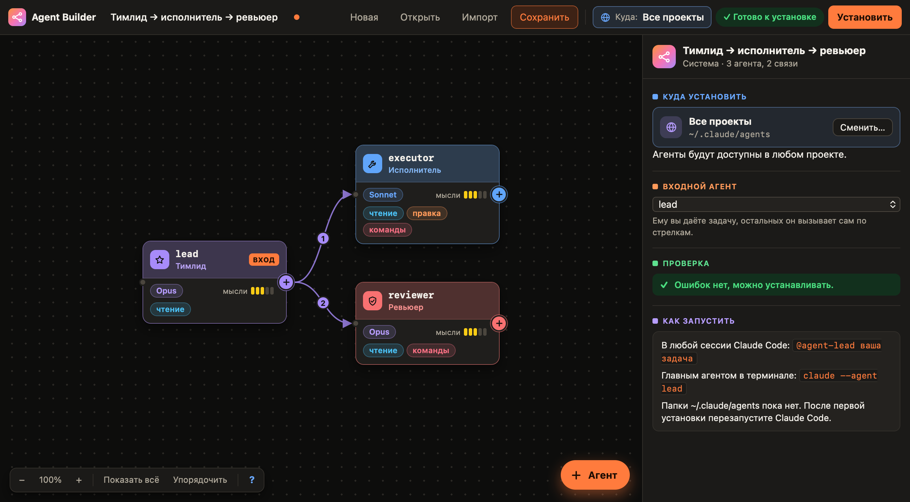

# Agent Builder

Визуальный конструктор мультиагентных систем для [Claude Code](https://code.claude.com).
Расставляете агентов на холсте, соединяете стрелками «кто кого вызывает», настраиваете
каждому модель, инструменты и промпт — и одной кнопкой устанавливаете готовые
сабагенты в Claude Code.



## Установка

1. Скачайте репозиторий:
   ```bash
   git clone https://github.com/CyberCzar01/Agent_orchestra.git
   ```
   или на GitHub: **Code → Download ZIP** и распакуйте.
2. Дважды щёлкните **Agent Builder.app**. Можно перетащить его в «Программы».

Больше ничего ставить не нужно: приложение само поднимает свой сервер при открытии
и выключает его при выходе.

### Если macOS не даёт открыть приложение

Приложение подписано без платного сертификата Apple, поэтому при скачивании через
**ZIP** macOS при первом запуске скажет, что не может проверить разработчика.
Это нужно разрешить один раз:

- **Системные настройки → Конфиденциальность и безопасность** → внизу
  «Agent Builder заблокировано…» → **«Всё равно открыть»**;
- или в Терминале, в папке с приложением:
  ```bash
  xattr -dr com.apple.quarantine "Agent Builder.app"
  ```

При скачивании через `git clone` этого предупреждения нет.

### Требования

- macOS 12 или новее, Apple Silicon или Intel.
- Python 3. Он уже есть, если на Mac установлены «Инструменты командной строки» Apple
  (их же ставит git). Если нет, приложение подскажет: `xcode-select --install`.
- Claude Code — чтобы пользоваться созданными агентами.

## Как пользоваться

1. **Куда ставить** — плашка «Куда:» вверху. Все проекты (`~/.claude/agents`) или
   конкретный проект: список ваших проектов с поиском и выбор папки в Finder.
   Если в проекте уже есть агенты, конструктор предложит загрузить их на холст.
2. **Добавить агента**:
   - кнопка **+ Агент** внизу справа;
   - **+** на карточке — добавить подчинённого, сразу связанного с ней;
   - потяните **+** на пустое место — новый агент встанет там;
   - двойной щелчок по холсту.
3. **Связать** — потяните **+** одного агента на другого. Стрелка значит «вызывает».
4. **Настроить** каждого справа: модель, глубину размышлений, инструменты, права, промпт.
5. **Установить** — конструктор покажет план изменений и запишет файлы.

Готовые шаблоны — кнопка «Открыть»: «Тимлид → исполнитель → ревьюер»,
«Разработка: план, код, тесты, ревью», «Исследование и текст».

Подсказка по жестам — кнопка **?** внизу холста.

### Запуск готовой системы в Claude Code

- В любой сессии: `@agent-lead ваша задача`
- Главным агентом: `claude --agent lead`
- Или отметьте «Запускать его в каждой новой сессии проекта» — конструктор пропишет
  входного агента в `.claude/settings.json`.

Если папка агентов появилась впервые, перезапустите Claude Code один раз.

## Что конструктор делает сам

- По стрелкам даёт агенту право вызывать подчинённых — `Agent(имена)` в `tools`.
- Дописывает в промпт раздел «Команда»: кого вызывать и чем они заняты;
  подчинённым — кому они отчитываются.
- Переводит русские имена в латиницу: «Проверяющий» → `proveryayushchiy`.
- Проверяет схему: одинаковые имена, пустые описания, циклы, слишком глубокие цепочки
  (Claude Code разрешает не больше трёх уровней вложенности).
- Показывает план перед установкой. Файлы, созданные не им, без вашего согласия не трогает.
- Перед изменением или удалением сохраняет прежнюю версию в резервную копию.
- «Импорт» загружает уже установленных агентов обратно на холст вместе со связями.

## Где что лежит

Данные — в `~/Library/Application Support/Agent Builder` (меню «Agent Builder →
Показать данные в Finder»):

| Файл | Что там |
|---|---|
| `draft.json` | черновик холста, переживает перезапуск |
| `systems/` | сохранённые системы |
| `installed.json` | какие файлы какой системой установлены |
| `backups/` | прежние версии изменённых и удалённых файлов |
| `server.log` | журнал работы |

Агенты устанавливаются в `~/.claude/agents/` или `<проект>/.claude/agents/`.

## Разработка

```
Agent Builder.app/   готовое приложение (собирается build.sh, лежит в репозитории)
app/server.py        локальный сервер на Python, только стандартная библиотека
app/static/          интерфейс: HTML, CSS, JS без сборки и зависимостей
native/main.swift    окно приложения: WebKit, меню, запуск и остановка сервера
native/AppIcon.icns  значок (пересобирается из app/static/icon.svg)
build.sh             сборка .app
```

- Пересобрать приложение: `bash build.sh` (нужен `swiftc` из Command Line Tools;
  `--install` заодно поставит его в `~/Applications`).
- Открыть в браузере без приложения: `python3 app/server.py`.
- Проверять правки в `app/` без пересборки:
  `AGENT_BUILDER_DIR="$PWD/app" "Agent Builder.app/Contents/MacOS/Agent Builder"`.

Сервер слушает только `127.0.0.1` и принимает запросы с токеном, который выдаёт
странице при запуске. Если код сервера обновился, запущенная копия перезапускается
сама, а страница перезагружается.

## Лицензия

MIT — см. [LICENSE](LICENSE).
